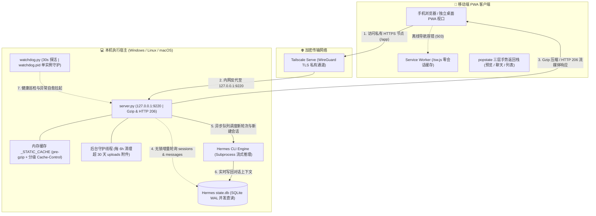

<div align="center">


# Hermes Web Remote

**零公网暴露、Tailscale 加密穿透的 Hermes Agent 轻量移动端 PWA 远程控制台**

*Lightweight, zero-exposure PWA mobile web remote console for Hermes Agent via Tailscale Serve.*

[](https://www.python.org/)
[](https://docs.python.org/3/library/)
[](https://tailscale.com/)
[](https://web.dev/progressive-web-apps/)
[](LICENSE)

[架构设计](#架构设计原理) · [核心特性](#核心特性亮点) · [工程深度解析](#底层工程机制深析) · [方案对比](#架构方案对比) · [从源码运行](#从源码运行-run-from-source) · [凭据与配置](#进阶配置与凭据管理) · [目录结构](#源码目录结构)

</div>

---

> [!IMPORTANT]
> **零公网端口暴露原则**：`server.py` 默认且仅绑定 `127.0.0.1` 本地回环地址，绝不直接向公网开放端口。所有远程访问严格经由 Tailscale WireGuard 虚拟私有网络加密反代，结合独立鉴权体系实现双重安全闭环。

## 架构设计原理

系统采用 **“零数据缓存 PWA 前端 + Tailscale 私有加密隧道 + 无外部依赖异步后端 + SQLite WAL 并发直读”** 四层解耦架构，实现手机端与电脑桌面端 Hermes 会话状态 100% 实时同源：



---

## 核心特性亮点

- **📲 原生级可安装 PWA 桌面应用**：内置 `manifest.webmanifest`、自适应图标与根作用域 Service Worker（`/sw.js`），支持 Android Chrome / Edge 一键安装至主屏幕与 iOS Safari 独立全屏视口；离线或 Tailscale 断连时自动呈现深浅主题自适应排障引导页。
- **🎬 HTTP `206` Byte-Range 流媒体断点续传**：完整实现 RFC 标准字节范围解析与分片流式下发（`206 Partial Content` / `416` 校验），手机端在线播放 `.mp4`、`.mov`、`.webm`、`.mp3`、`.flac` 等大体积音视频支持任意进度条拖拽秒开。
- **🗜️ 全链路 Gzip 实时压缩与分级缓存**：动态 JSON 与文本静态资源超过 1 KB 自动启用 Gzip 压缩传输；按资源类型精细实施缓存策略（应用主入口 `no-store`、第三方库与图标 `30` 天强缓存），大幅节省移动蜂窝流量与首屏加载耗时。
- **⚡ 乐观上屏与无阻断手势交互**：发送消息与新建会话即刻本地渲染乐观气泡（`你 · 发送中…`），待后台 SQLite 落库后平滑无缝替换；集成系统边缘滑动返回栈、无阻断悬浮 `toast()` 通知栈及系统深浅主题自动跟随。
- **🔐 开箱即用凭据管理与跨平台零依赖**：后端 100% 基于 Python 标准库构建，无需 `pip install` 任何第三方依赖；Windows 端双击批处理即可完成 Python 探测、`.env` 自动建档与终端直显、Tailscale 隧道打通与看门狗拉起。

---

## 底层工程机制深析

<details>
<summary><b>展开查看 6 大核心模块源码级实现细节</b></summary>

1. **HTTP Range 流媒体与扩大媒体白名单 (`_parse_byte_range` & `FILE_MIMES`)**
   - 精准解析单区间 `bytes=start-end`、开放结尾 `bytes=start-` 与后缀分片 `bytes=-suffix`，严格检查边界溢出并返回 `Accept-Ranges: bytes` 与 `Content-Range`，文件读取采用 `f.seek(start)` + 64 KB 块增量下发。
   - 媒体安全白名单 `MEDIA_EXT` 覆盖图片（含 `.heic`/`.heif`/`.bmp`/`.svg`）、音视频（`.mp4`/`.webm`/`.mov`/`.mp3`/`.m4a`/`.wav`/`.flac`）及 Office/PDF/文本格式，同时通过 `SENSITIVE_NAME` 硬拦截 `config.yaml`、`.env`、`state.db`、`auth.json` 等核心敏感文件。

2. **零会话缓存 PWA 安全边界 (`static/sw.js` & `static/index.html`)**
   - 与传统 PWA 不同，`sw.js` 在 `fetch` 事件中显式放行所有 `/api/` 请求与静态脚本，**仅接管 `req.mode === "navigate"` 的页面导航请求**。对话数据与私钥永远不会写入浏览器 Cache Storage，兼顾桌面化便捷与数据绝对安全性。

3. **移动端浏览历史栈治理 (`pushChatHistory` / `pushPreviewHistory` / `popstate`)**
   - 针对手机端“从边缘右滑直接退出整个页面”的常见痛点，前端使用 `history.pushState` 维护严格的三级状态机：**文档/媒体预览浮层 $\rightarrow$ 会话聊天页 $\rightarrow$ 会话列表**；关闭预览浮层时同步执行 `pause()`、`src = ""` 与 `load()` 释放后台音视频解码资源。

4. **客户端 LRU 内存治理与系统主题实时联动 (`_fileBlobCache` & `initTheme`)**
   - 前端文件预览缓存采用基于 `Map` 插入序淘汰的 LRU 策略（`MAX_BLOB_CACHE = 5`），且清理附件缩略图前主动调用 `URL.revokeObjectURL()`，防止移动端浏览器因大文件预览发生 OOM 崩溃。
   - 未手动指定主题时实时监听 `matchMedia("(prefers-color-scheme: light)")` 系统变化事件，联动更新 `<meta name="theme-color">` 以融合移动设备刘海/状态栏色。

5. **双源 `mtime` 缓存鉴权与 `.env` 热感知 (`_AUTH_CACHE` & `_read_env_dict`)**
   - 每个请求高频鉴权时仅校验 `(CONFIG_YAML, .env)` 双文件的 `st_mtime_ns`，未变更时直接命中线程安全内存缓存；一旦修改 `.env` 密码，下一次请求立即零重启生效，兼顾低 I/O 开销与热更新体验。

6. **存储空间自净与单实例看门狗守护 (`_cleanup_loop` & `watchdog.py`)**
   - 服务主进程启动独立守护线程每 6 小时扫描一次 `uploads/`，自动清理超过 `UPLOAD_TTL_DAYS = 30` 天的历史上传附件；`watchdog.py` 内置基于 `watchdog.pid` 的单实例防重锁，支持 `--stop` 信号与 `停止网站.bat` 联动彻底下线。

</details>

---

## 架构方案对比

| 评估维度 | 传统公网反代 + FRP 穿透 | Hermes Web Remote |
| :--- | :--- | :--- |
| **公网端口暴露** | 需开放服务器端口并暴露源站 IP | **0 端口暴露**，仅监听 `127.0.0.1` + Tailscale 私有内网 |
| **依赖与安装体积** | 需安装 Nginx / Node / Flask 等依赖栈 | **Python 原生标准库 0 三方依赖** |
| **桌面/移动数据一致性** | 需单独同步 API 或复制会话库 | **直连同一 `state.db` (SQLite WAL)**，毫秒级同源同步 |
| **手机端大视频播放** | 普通静态代理易卡顿或无法拖拽 | **原生 HTTP `206` Byte-Range 分片流媒体**，支持任意拖拽 |
| **移动流量占用** | 明文 JSON 与脚本全量传输 | **内存预压缩 Gzip + 30 天分级缓存**，流量消耗大幅降低 |
| **桌面应用级体验** | 易受浏览器地址栏与边缘返回误退困扰 | **独立 PWA 桌面启动 + 三层手势返回栈 + 非阻塞 Toast** |

---

> [!TIP]
> 本项目坚持纯正轻量工程架构：**对 Hermes 客户端配置文件 `config.yaml` 全程严格只读**，不会改动您电脑中现有的模型、API Key 或其他桌面设置；账号密码完全隔离保存在项目本地 `.env` 文件中，`.gitignore` 已屏蔽所有敏感与运行期状态文件。

---

## 从源码运行 (Run from Source)

### 1. 前置环境 (Prerequisites)

- **操作系统**：Windows 10 / 11，或 Linux / macOS
- **Python 版本**：Python **3.10+**（纯标准库运行，无需 `pip install` 额外包）
- **必备基础**：
  - 本机已安装并初始化 **Hermes Agent**
  - 电脑端与手机端已登录**同一个 Tailscale 账号**（并启用 Tailscale Serve / HTTPS 支持）

### 2. 克隆与启动

#### 第一步：克隆仓库
```bash
git clone https://github.com/Luofeng-Cloud/Hermes-Web-Remote.git
cd Hermes-Web-Remote
```

#### 第二步：启动服务与内网安全穿透
- **Windows 用户（开箱即用推荐）**：
  直接双击仓库根目录下的 **`启动网站.bat`**，脚本将全自动完成：
  1. 6 级自适应嗅探本机可用的 Python 运行环境（无需手动配置环境变量）；
  2. 若无 `.env` 文件，自动生成独立凭据配置（默认账号 `hermes`，默认密码 `hermes123`）；
  3. 后台无窗口静默拉起 `server.py` 与 `watchdog.py` 单实例看门狗；
  4. 自动执行 `tailscale serve --bg --set-path /app http://127.0.0.1:9220`，并在控制台屏幕直接高亮输出**手机专属 HTTPS 链接**与**登录账号密码**。
  *(需要停止或重启服务时，直接双击 **`停止网站.bat`** 或 **`重启网站.bat`** 即可完整联动启停主服务与看门狗。)*

- **Linux / macOS 用户**：
  ```bash
  cp .env.example .env
  # 按需编辑 .env 修改 HERMES_WEB_USER / HERMES_WEB_PASSWORD
  python3 server.py &
  python3 watchdog.py &
  tailscale serve --bg --set-path /app http://127.0.0.1:9220
  ```

#### 第三步：手机端访问与桌面化安装
1. 在手机浏览器（Safari / Chrome / Edge）打开终端输出的 `https://<你的Tailscale节点域名>/app/`；
2. 输入终端回显的登录账号与密码完成登录；
3. 点击右上角 **`📲 桌面`**（或使用浏览器“添加到主屏幕”）即可作为独立 PWA 全屏应用使用。

---

## 进阶配置与凭据管理

首次运行将在根目录自动生成 `.env`（受 `.gitignore` 保护，绝不会被提交至仓库）。修改凭据后**无需重启服务，下次登录即刻生效**：

| 配置项 / 环境变量名 | 作用说明 | 默认行为 / 兜底值 |
| :--- | :--- | :--- |
| `HERMES_WEB_USER` | Web 控制台登录用户名 | `hermes`（或读取 `config.yaml` 中 `basic_auth.username`） |
| `HERMES_WEB_PASSWORD` | Web 控制台登录口令（支持免重启热生效） | `hermes123`（`.bat` 首次运行自动写入 `.env`） |
| `HERMES_HOME` | Hermes 数据与 `state.db` 根目录 | 自动探测 `%LOCALAPPDATA%\hermes` 或 `~/.hermes` |
| `PORT` | 本地监听端口 | `9220` |

> [!NOTE]
> `verify_password()` 支持两种校验模式：当 `.env` 或环境变量显式配置了 `HERMES_WEB_PASSWORD` 时优先生效；若未配置明文口令，则回退兼容 `config.yaml` 中 `dashboard.basic_auth.password_hash` 的 `scrypt` 哈希校验。

---

## 源码目录结构

```text
Hermes-Web-Remote/
├── static/                         # 移动端 PWA 与多格式渲染前端资源
│   ├── index.html                  # 单文件响应式 WebUI（乐观渲染/手势返回栈/主题联动）
│   ├── manifest.webmanifest        # PWA 应用清单（独立视口/桌面图标声明）
│   ├── sw.js                       # 极简 Service Worker（零 API 缓存 + 离线容错页）
│   ├── icon-192.png                # PWA 标准桌面图标 (192x192)
│   ├── icon-512.png                # PWA 启动屏与高分图标 (512x512)
│   └── *.min.js                    # Markdown / DOMPurify / Chart.js / Office 本地解析库
├── uploads/                        # 附件上传缓冲区（仅保留 .gitkeep；30 天自动过期清理）
├── server.py                       # 零依赖后端主进程（WAL 直读/鉴权/Gzip/206 Range/队列）
├── watchdog.py                     # 独立健康巡检看门狗（支持单实例 PID 锁与 --stop 退出）
├── 启动网站.bat                     # Windows 全自动启动脚本（环境探测/.env/.ts隧道/守护）
├── 重启网站.bat                     # Windows 服务安全重启批处理
├── 停止网站.bat                     # Windows 联动停止批处理（先停看门狗再停主服务）
├── .env.example                    # 环境变量配置模板（脱敏）
├── .gitignore                      # Git 安全忽略规则（屏蔽 .env / logs / pids / uploads）
├── LICENSE                         # MIT 开源许可证
└── README.md                       # 项目技术文档
```

---

## 开源协议

本项目基于 [MIT License](LICENSE) 协议开源。
