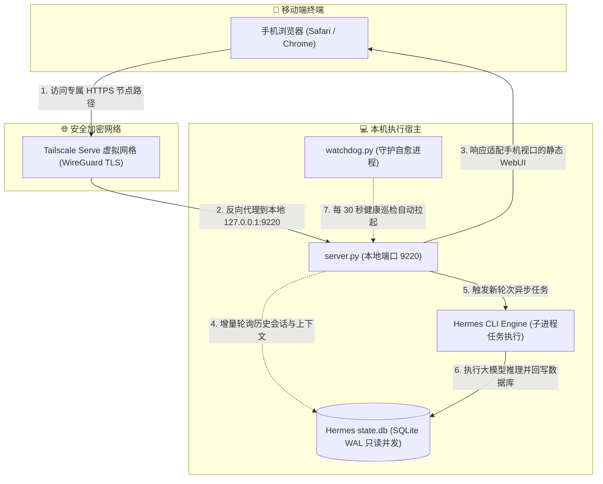

# Hermes Web Remote (移动端私有远程 Web 控制台)

[](https://www.python.org/)
[](https://opensource.org/licenses/MIT)
[](https://tailscale.com/)

Hermes Web Remote 是一款专为 [Hermes Agent](https://github.com/...) 打造的轻量级移动端 Web 远程交互控制台。无需公网 IP 与繁琐的端口映射，通过本地轻量服务结合 Tailscale 安全加密隧道，让用户在手机浏览器上随时随地获得与桌面端 100% 同步的 AI 对话与工具调度体验。

---

## 架构设计原理

系统采用 **“本地异步服务 + 预写日志数据库穿透 + CLI 引擎调度 + 端到端加密隧道”** 四层解耦架构：



---

## 核心特性

- **📱 极致移动端交互体验**：专为手机触控优化的响应式 WebUI，支持对话历史切换、实时打字机流式渲染、代码高亮、Markdown 渲染及多种多媒体文件直接预览。
- **🔒 零公网暴露与原生安全性**：本地服务默认仅监听 `127.0.0.1` 环回接口；对外访问由 Tailscale Serve 提供基于 WireGuard 协议的私有 HTTPS 证书通道，抵御外网端口扫描。
- **⚡ SQLite WAL 双向并发直读**：利用 SQLite 预写日志（Write-Ahead Logging）无锁读取机制，手机端浏览历史与桌面端运行时完全并发，互不干扰、绝不锁库。
- **🛡️ 原生鉴权体系复用**：复用 Hermes 原生账户口令哈希（scrypt 散列校验）及长效安全 Session 凭据，防止未授权访问。
- **🩺 高可用看门狗守护**：配备独立轻量级守护脚本，具备异常自动重启与毫秒级服务自愈能力。

---

## 开发者从源码运行 (Run from Source)

### 1. 前提要求 (Prerequisites)

- **操作系统**：Windows 10 / 11 或 Linux / macOS
- **Python 环境**：Python 3.10+
- **前置依赖**：
  - 本地已正确安装并初始化 [Hermes Agent](https://github.com/...)
  - 本地设备与手机端均已登录同一个 Tailscale 账号

---

### 2. 部署与启动步骤

#### 步骤一：克隆代码仓库
```bash
git clone https://github.com/Luofeng-Cloud/Hermes-Web-Remote.git
cd Hermes-Web-Remote
```

#### 步骤二：一键启动服务与安全穿透
- **Windows 用户 (推荐)**：
  直接双击根目录下的 **`启动网站.bat`**。
  *(脚本将自动嗅探 Python 核心、后台静默拉起服务，并**全自动配置打通 Tailscale 隧道**；同时自动初始化凭据并在屏幕高亮回显手机专属访问链接与登录账号密码，真正 0 门槛开箱即用！)*
- **Linux / macOS 用户**：
  ```bash
  python3 server.py
  tailscale serve --bg --set-path /app http://127.0.0.1:9220
  ```

#### 步骤三：手机端直接访问
在手机浏览器（Safari / Chrome）中打开终端窗口输出的专属 HTTPS 链接：
- **默认账号**：`hermes`
- **默认密码**：`hermes123` *(首次运行自动生成至本地 `.env` 文件中，可随时按需修改)*

---

## 进阶配置与安全凭据管理

项目具备极高的自适应能力，首次启动自动在根目录创建 `.env` 文件。你可随时用文本编辑器修改 `.env` 进行自定义：

| 配置项 / 环境变量名 | 说明 | 默认值 |
| :--- | :--- | :--- |
| `HERMES_WEB_USER` | Web 控制台登录用户名 | `hermes` (或自动读取 `config.yaml`) |
| `HERMES_WEB_PASSWORD` | Web 控制台登录口令 | `hermes123` (开箱默认，保存在 `.env` 中) |
| `HERMES_HOME` | Hermes 配置与数据库根目录 | 自动探测系统标准路径 (`%LOCALAPPDATA%\hermes`) |
| `PORT` | 本地服务监听端口 | `9220` |

---

## 目录结构说明

```text
hermes-web-remote/
├── static/                   # 移动端 WebUI 静态资源库 (Markdown/Chart/Office 预览等)
├── uploads/                  # 运行期文件传输缓冲区 (.gitkeep 占位)
├── server.py                 # 后台 Web API 与任务路由主进程
├── watchdog.py               # 独立服务探活看门狗脚本
├── 启动网站.bat               # Windows 一键静默启动批处理 (动态相对寻址)
├── 重启网站.bat               # Windows 服务重启批处理
├── 停止网站.bat               # Windows 服务终止批处理
├── .env.example              # 环境变量配置模板
├── .gitignore                # Git 忽略规则
├── LICENSE                   # 开源许可证 (MIT)
└── README.md                 # 技术文档
```

---

## 开源协议

本项目基于 [MIT License](LICENSE) 协议开源。
